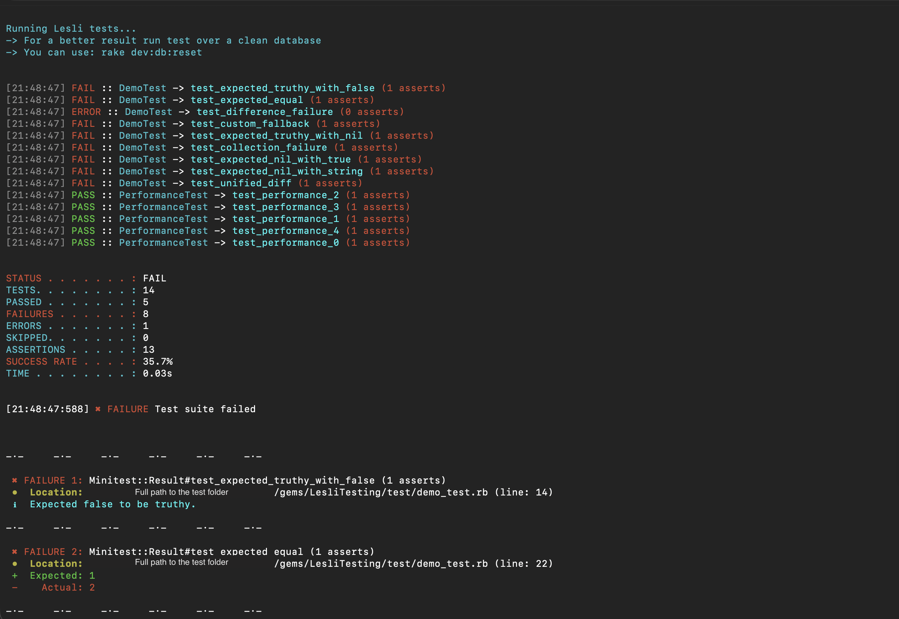

<div align="center">
    <h1 align="center">
        
    </h1>
    <h3 align="center">Shared testing, reporting, and coverage tools for the Lesli Framework.</h3>
</div>

<br />

<div align="center">
    <a target="_blank" href="https://github.com/LesliTech/LesliTesting/actions/workflows/lesli-ci-gem.yaml">
        
    </a>
    <a target="_blank" href="https://rubygems.org/gems/lesli_testing">
        
    </a>
    <a target="_blank" href="https://codecov.io/github/LesliTech/LesliTesting">
        
    </a>
    <a target="_blank" href="https://sonarcloud.io/project/overview?id=LesliTech_LesliTesting">
        
    </a>
</div>

<br />

<div align="center">
    
</div>

<br />

---

<br />

## Introduction

LesliTesting provides the shared test configuration used across the [Lesli Framework](https://github.com/LesliTech/Lesli).

It standardizes Minitest output, SimpleCov profiles, coverage reports, and fixture loading for Rails applications, engines, and Ruby gems.

<br />

## Features

- Coverage profiles for Rails applications, Rails engines, and Ruby gems
- A human-friendly Minitest reporter with per-test timing and failure details
- SimpleCov console and Cobertura reports
- Configurable minimum coverage thresholds
- Shared base classes for integration, model, and view tests
- Automatic engine, shared Lesli fixture, and migration paths

<br />

## Quick start

Add LesliTesting to the test group:

```shell
bundle add lesli_testing --group test
```

Require the gem from `test/test_helper.rb` and select exactly one profile for
the project. Configure LesliTesting before loading Rails or the library under
test.

### Rails application

```ruby
ENV["RAILS_ENV"] ||= "test"

require "lesli_testing"
LesliTesting.app("LesliBuilder", coverage_min_coverage: 90)

require_relative "../config/environment"
require "rails/test_help"
```

### Rails engine

```ruby
ENV["RAILS_ENV"] ||= "test"

require "lesli_testing"
LesliTesting.engine("LesliShield", coverage_min_coverage: 90)

require_relative "dummy/config/environment"
require "rails/test_help"
```

### Standalone Ruby gem

```ruby
$LOAD_PATH.unshift File.expand_path("../lib", __dir__)

require "lesli_testing"
LesliTesting.gem("Termline", coverage_min_coverage: 90)

require "minitest/autorun"
require "termline"
```

Engine suites that use the shared Rails test classes should run through
`bundle exec rails test` or `bundle exec rake app:test`.

Rails engines should keep a complete generated dummy application and verify eager loading locally before pushing:

```shell
CI=true bundle exec rails test
```

LesliTesting does not provide an engine's runtime dependencies. Declare dependencies such as `lesli` explicitly in the engine gemspec and Gemfile so local and CI dependency resolution match.

For Rails applications and engines, `Lesli` is always included as the shared testing base. Engine profiles use the configured engine name to discover its `Engine` class after the dummy application boots and register the target and Lesli fixture and migration paths. Migration paths are modified only in the test environment. Pure Ruby gems remain independent from Rails and Lesli integrations.

## Definitive load order

LesliTesting initializes in five phases:

1. `require "lesli_testing"` reads `COVERAGE` and starts native Ruby line
   coverage immediately when enabled.
2. `LesliTesting.app`, `.engine`, or `.gem` selects the profile, attaches
   SimpleCov, and registers the Minitest reporter.
3. Rails applications and engines boot their environment. ActiveSupport load
   hooks install fixtures and shared test classes; the engine Railtie registers
   migration paths only in the test environment.
4. `rails/test_help` or `minitest/autorun` loads Minitest and the test files.
   LesliTesting replaces any previously registered reporter when Minitest starts.
5. At process exit, Minitest sets the suite result and SimpleCov writes
   `coverage/coverage.xml` and enforces the coverage threshold.

Loading the application, engine, or gem before steps 1 and 2 prevents coverage
from observing code that Ruby already evaluated.

## Running tests

Run the suite normally or enable coverage with `COVERAGE=true` (`1` and `yes`
are also accepted):

```shell
bin/rails test
COVERAGE=true bin/rails test

bundle exec rake
COVERAGE=true bundle exec rake
```

Set `QUIET=true` (`1` and `yes` are also accepted) to hide individual test lines while retaining the summary and failure details. Values such as `false`, `0`, and `no` leave the option disabled.

### Environment variables

| Variable | Default | Enabled values | Effect |
| --- | --- | --- | --- |
| `COVERAGE` | Disabled | `true`, `1`, `yes` | Starts line coverage and writes console and Cobertura reports. |
| `QUIET` | Disabled | `true`, `1`, `yes` | Hides per-test lines but keeps the summary and failure details. |

Values are case-insensitive and surrounding whitespace is ignored. Every other
value, including `false`, `0`, and `no`, is disabled.

### Exit codes

| Code | Meaning |
| ---: | --- |
| `0` | The suite passed. Skipped tests do not make the process fail. |
| `1` | A test failed, raised an unexpected exception, emitted a warning under `-Werror`, or an explicit test filter matched no tests. |
| `2` | Tests completed, but SimpleCov found coverage below `coverage_min_coverage`. |

Dependency installation, Ruby boot, signals, and operating-system failures may
return other non-zero codes. `QUIET` changes output only and never changes the
process result.

<br />

## Guides

- [Installation and configuration](docs/about/installation.md)
- [Load order, environment, and exit codes](docs/about/execution.md)
- [Testing Rails applications](docs/testing/applications.md)
- [Testing Rails engines](docs/testing/engines.md)
- [Testing Ruby gems](docs/testing/gems.md)
- [Reporter, coverage, fixtures, and test helpers](docs/about/tools.md)
- [Recommended project and gem structure](docs/about/structure.md)

<br />

## Development

Clone the repository and install its dependencies:

```shell
git clone https://github.com/LesliTech/LesliTesting.git
cd LesliTesting
bundle install
```

To use local source from a Lesli development workspace, reference it from the host application's `Gemfile`:

```ruby
gem "lesli_testing", path: "gems/LesliTesting"
```

### Tests

Run the default test task from the LesliTesting directory:

```shell
bundle exec rake
COVERAGE=true bundle exec rake test
bundle exec rake build
```

The LesliTesting repository enforces a 45% coverage baseline. Rails integration
behavior is tested in isolated Ruby processes, so those executed lines are not
merged into the parent process report. Consumer projects keep the public 90%
default unless they configure another threshold.

Run the intentional reporter failures manually when visually inspecting its output:

```shell
bundle exec ruby examples/reporter_demo.rb
```

The demo command is expected to fail and is intended for visually checking failure formatting.

Run the optional reporter benchmark separately from the test suite. It renders 5,000 results by default:

```shell
bundle exec ruby benchmark/reporter_benchmark.rb
ITERATIONS=10000 bundle exec ruby benchmark/reporter_benchmark.rb
```

<br />

## Documentation

- [Lesli website](https://www.lesli.dev/)
- [Documentation](https://www.lesli.dev/gems/testing/)
- [Release notes](https://github.com/LesliTech/LesliTesting/releases)
- [Issue tracker](https://github.com/LesliTech/LesliTesting/issues)
- [Source code](https://github.com/LesliTech/LesliTesting)

<br />

## Community

- [X: @LesliTech](https://x.com/LesliTech)
- [hello@lesli.tech](mailto:hello@lesli.tech)
- [https://www.lesli.tech](https://www.lesli.tech)

<br />

## License

Copyright (c) 2026, Lesli Technologies, S. A.

This program is free software: you can redistribute it and/or modify
it under the terms of the GNU General Public License as published by
the Free Software Foundation, either version 3 of the License, or
(at your option) any later version.

This program is distributed in the hope that it will be useful,
but WITHOUT ANY WARRANTY; without even the implied warranty of
MERCHANTABILITY or FITNESS FOR A PARTICULAR PURPOSE. See the
GNU General Public License for more details.

You should have received a copy of the GNU General Public License
along with this program. If not, see [https://www.gnu.org/licenses/](https://www.gnu.org/licenses/).

The complete license text is available in the [license file](./license).

---

<br />
<br />

<div align="center">
    
    <h3 align="center">The Open-Source SaaS Development Framework for Ruby on Rails.</h3>
</div>
